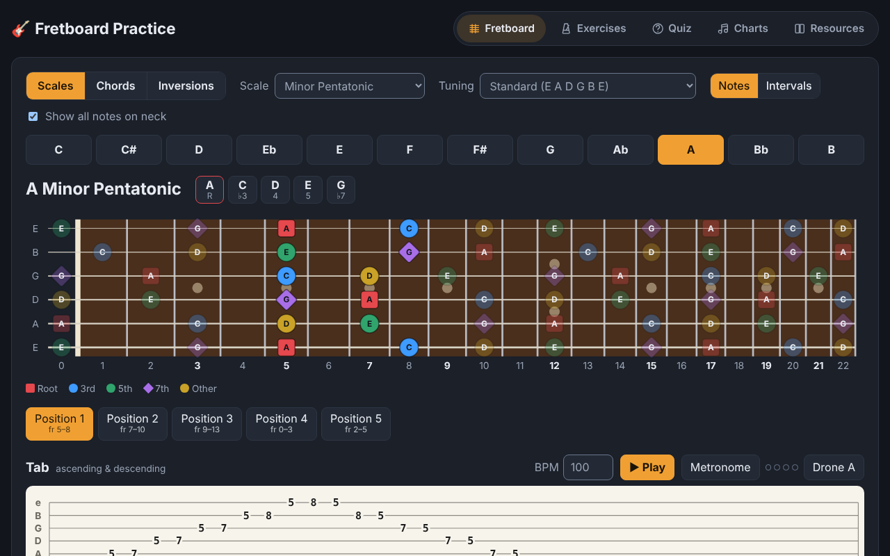
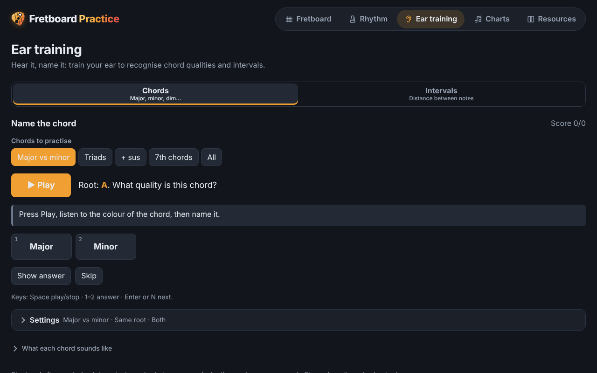

<div align="center">


# Fretboard Practice

**Scales, chords, ear training and drum grooves to play along with, all in one guitar practice site.**

[](https://github.com/joeyf116/music/actions/workflows/deploy.yml)


### [▶ Open the live site](https://joeyf116.github.io/music/)



</div>

---

## Contents

- [What's inside](#whats-inside)
- [Fretboard](#-fretboard)
- [Drums](#-drums)
- [Training](#-training-ear-and-theory)
- [Community links](#-community-links)
- [Works everywhere](#-works-everywhere)
- [Shared catalogs (Supabase)](#-shared-catalogs-supabase)
- [Design system](#-design-system)
- [Development](#-development)
- [Project layout](#-project-layout)
- [Deployment](#-deployment)

## What's inside

| Page | What it's for |
| --- | --- |
| 🎯 **[Fretboard](https://joeyf116.github.io/music/#fretboard)** | See any scale, chord or inversion on a 22-fret neck, with tab you can play back |
| 🪘 **[Drums](https://joeyf116.github.io/music/#drums)** | Grooves on a recorded drum kit to play along with |
| 👂 **[Training](https://joeyf116.github.io/music/#quiz)** | Name chord qualities and intervals by ear, and drill building the chords of any key |
| 💬 **[Community](https://joeyf116.github.io/music/#community)** | Posts about what you're practising or stuck on, and a shared list of lessons, tabs, videos and tools anyone can add to |

Each page has its own link, your settings are remembered in the browser, and nothing needs an account. Every page
is laid out the same way: a title and one line on what it's for, the few choices you change most, the thing you
practise with, and a folded **Settings** panel for everything else (see [Design system](#-design-system)).

## 🎯 Fretboard

- **Pick a key and a scale or mode once.** They're remembered across visits. The key's chords sit right under the keys; tap one to see its voicings.
- **Two views:**
  - **Scale:** major, minor, pentatonics, blues, harmonic and melodic minor, and every mode, in playable positions (boxes or diagonal 3-notes-per-string runs, set in Settings) or across the whole neck.
  - **Chords:** one voicing at a time, stepped with ‹ › (or ← / →). Pick the voicing type: **Shapes** (open and barre chords), **CAGED** (each shape inside its pentatonic box), **Triads** on every string set, or **Drop 2** / **Drop 3** for 7th chords. Any of 17 chord types can replace the key's own in Settings.
- **Pin to practice tab** adds whatever is on the neck (a voicing, a CAGED shape and its box, or a scale run) to the **practice tab**. Pinned items keep their own frets and key, so you can mix keys in one session.
- **The practice tab plays everything pinned as one looping tab**, with the cursor following the sound, at any BPM, with an optional click and a drone on the key. Reorder or remove items, set how many beats a chord rings, choose strum, arpeggio or block chords, or start from a common or random progression. On a phone a small bar above the tab bar keeps it one tap away.
- **Notes are coloured and shaped by role** (root, 3rd, 5th, 7th, other), so the neck reads even without colour. Labels can show note names or intervals.
- **25 tunings** in five groups: standard down to B, drop tunings, open tunings, math rock (FACGCE, open C6, open F) and more. Tuning, labels and "show every note" live in **Settings**.

## 🪘 Drums

Grooves to play along with on real recorded drum kits, or a plain metronome (the **Groove · Metronome** switch at the top):

- **60 ready-made grooves** across rock, pop, funk, R&B & soul (gospel too), hip-hop, lo-fi, jazz, Latin (samba, salsa, cha-cha-chá, bossa nova, reggaeton), Afro & Caribbean (afrobeat, afrobeats, reggae, soca), electronic (house, techno, drum & bass, breakbeat), country, blues and punk/metal, shown as mini grids. Press one to load it and hear it.
- **Four recorded kits, not synthesised:** Rock ([Big Rusty Drums](https://github.com/sfzinstruments/karoryfer.big-rusty-drums)), Jazz ([Virtuosity Drums](https://github.com/sfzinstruments/virtuosity_drums)), Brushes ([Swirly Drums](https://github.com/sfzinstruments/karoryfer.swirly-drums)) and Lo-fi ([Gogodze Phu Vol II](https://github.com/sfzinstruments/karoryfer.gogodze-phu-vol-ii)), plus hand percussion (cowbell, claves, tambourine, shaker, congas, bongos) from Virtuosity Drums. All CC0. Picking a groove picks the kit it suits; change it with **Kit** next to the tempo. A drum a kit wasn't recorded with is played by the nearest one (the lo-fi kit borrows the jazz kit's cymbals). Every drum has several velocity layers and round-robin takes, so accents, normal hits and ghost notes sound different and repeated notes never sound like a machine. A closed hi-hat chokes a ringing open one, as on a real kit.
- **Change any step:** pick Hit, Accent or Ghost and press a step to paint it, drag along a row to paint more, press a painted step to clear it. Mute, solo or turn down any drum, add or remove drums, and undo anything (Ctrl+Z). The grid works from the keyboard too: arrow keys move, Space paints or clears, 1 / 2 / 3 paint a hit, accent or ghost.
- **Settings:** time signature (4/4, 3/4, 5/4, 6/8, 9/8, 12/8), 1, 2 or 4 bars, swing, humanize for a drummer's small timing and loudness changes, and a recorded click (claves, cowbell or side stick) on every beat over the groove. Your groove is kept when you come back.
- Tempo, and the step being heard lit up on the grid.
- Rebuild the samples with `python3 scripts/build-drum-kits.py` (needs ffmpeg and numpy).

## 👂 Training: ear and theory



Three tabs, each one question at a time. On the ear tabs press **Play**, listen, pick the answer. Wrong picks stay silent so they're never mistaken for the next question, and once you've answered you can tap every option to compare.

- **Chords:** name the quality. Start with *Major vs minor*, then add triads, sus chords and 7th chords (11 qualities in all). Hear them as an arpeggio, a strum or both, on one root or any root, in close voicing or a real guitar shape, with optional inversions. The answer shows the shape on the neck.
- **Intervals:** the root is shown on the neck and you name the gap. Start with the presets (Starter, + 3rds & 4th, All), play the notes up, down, together or mixed, and set the fret range.
- **Theory:** learn to build chords in a key. *Build* shows a key's scale and you tap the chord's notes (stack every other note), then say whether it's major, minor or diminished. *Name* asks for the 4th chord in E major, or which number Am is in G major. *Spell* asks for the notes of any chord (Spell Bm7♭5) or names a chord from its notes. Triads or 7ths, major, minor or all seven modes, any key or just yours. A wrong tap gets a hint about the method, and every answer shows the working: the formula, the 3rds stacked, and the key's chord pattern (I ii iii IV V vi vii°).
- Score, streak and accuracy per chord or interval, so you know what to practise next.

## 📚 Community links

The Community page's **Links** view (`#resources`) is a practice catalog of PDFs, tabs, lessons, videos, backing tracks and tools:

- Filter by type, tag, level and category, search every field, sort by newest and star your favourites.
- Look any song up on Songsterr, Ultimate Guitar or YouTube with the tab finder.
- **+ Add a link** shares a link with every visitor, or keeps it in your own browser.
- Files dropped into [`resources/`](resources/README.md) (sub-folders become categories) and links in `resources/links.json` are bundled with the site.

## 📱 Works everywhere

- Phones get a bottom tab bar within thumb reach and nothing pinned over the top of the page. The main thing on each page (the neck, the quiz, the metronome) comes first; extra options fold away.
- Touch targets are 44px, the neck scrolls to the selected shape, and tab reflows to the screen.
- Fields never trigger zoom on iOS, contrast meets WCAG AA, and keyboard focus is always visible.
- The site is fully static and works on GitHub Pages or any sub-path.

## 🗄️ Shared catalogs (Supabase)

Shared resources and accounts are stored in a free [Supabase](https://supabase.com) project (`guitar-music`). The site talks to it with plain `fetch`, so there's no SDK to install. The public anon key in [`.env.production`](.env.production) is safe to publish, because database rules decide what it can do:

- Visitors can **read** approved rows, **add** a row, **edit or remove their own** (with a secret token kept in their browser) and **report** a row. A row is hidden automatically after 3 reports.
- Flood limits, length checks and URL checks run in the database.

| File | What it sets up |
| --- | --- |
| [`supabase/schema.sql`](supabase/schema.sql) | Shared resources table and functions |
| [`supabase/accounts.sql`](supabase/accounts.sql) | Profiles for signed-in users (Google login) |

Setup steps are in [`supabase/README.md`](supabase/README.md). If the database can't be reached, every page still works: shared items are simply hidden.

## 🎨 Design system

All pages follow the rules in [`docs/DESIGN.md`](docs/DESIGN.md): the page anatomy (title and purpose → setup →
stage → folded settings → reference), the spacing, type and colour tokens in [`src/index.css`](src/index.css),
which control to use for which kind of choice, and mobile and accessibility checklists. The shared building blocks
are in [`src/components/layout.jsx`](src/components/layout.jsx) (`PageHeader`, `Disclosure`, `Section`) and
[`src/components/controls.jsx`](src/components/controls.jsx) (`Field`, `Choice`, `Stepper`, `Toggle`). Read it
before adding a page or a control.

## 📱 iPhone, iPad and Android app

**Paused:** the web site installs to a phone's home screen and works offline, so new work goes there; the app isn't kept level with it for now.

[`mobile/`](mobile) is the native app (Expo / React Native) with the Fretboard, Training and Resources pages rebuilt from the platform's own
controls. It shares the music logic and the page logic in `src/lib` with this site, so a fix there fixes both.
How to run it is in [`mobile/README.md`](mobile/README.md); getting it into the stores is in
[`mobile/PUBLISHING.md`](mobile/PUBLISHING.md).

## 🛠 Development

```bash
npm install
npm run dev          # dev server with hot reload
npm test             # unit tests (Vitest)
npm run lint         # lint (oxlint)
npm run build        # production build into dist/
```

To use the shared catalogs locally, copy the two `VITE_SUPABASE_*` lines from `.env.production` into `.env.local` (git-ignored).

## 🗂 Project layout

```text
src/
├── App.jsx                 page list, header and tab bar, shared key / scale / tuning
├── index.css               design tokens, form controls      App.css  page layout and page styles
├── components/
│   ├── layout.jsx          PageHeader, Disclosure, Section (see docs/DESIGN.md)
│   ├── controls.jsx        Field, Choice, Stepper, Toggle
│   ├── FretboardPage.jsx   Fretboard page                   DrumsPage.jsx    Drums page
│   ├── EarTraining.jsx     Ear training page (ChordQuiz, IntervalQuiz)
│   ├── Resources.jsx       Community links                  AccountPage.jsx  Log in with Google
│   └── …                   widgets: Fretboard, Tab, Metronome, PracticeTab, …
└── lib/
    ├── theory.js           notes, scales, chords, voicings, inversions, tunings
    ├── exercises.js        drill generators            player.js        tab playback
    ├── rhythm.js           metronome meters, subdivisions, trainers   clickSounds.js   metronome sounds
    ├── intervalQuiz.js     interval quiz logic         chordQuiz.js     chord quiz logic
    ├── audio.js            plucked-string synth, metronome, drone
    ├── drumEngine.js       drum groove scheduler       drumLoops.js     groove library
    ├── *View.js            page logic shared with the app (fretboard, metronome, quizzes)
    └── shared*.js          Supabase calls for shared resources
docs/DESIGN.md              layout, theme and writing rules for every page (web and app)
mobile/                     the native app (see mobile/README.md)
supabase/                   database SQL
resources/                  bundled PDFs, files and links
```

The music logic is plain JavaScript with tests next to it (`*.test.js`), separate from the React components.

## 🚀 Deployment

[`.github/workflows/deploy.yml`](.github/workflows/deploy.yml) lints, tests and builds every push and pull request, then deploys `dist/` to GitHub Pages on pushes to `main`.

One-time setup: **Settings → Pages → Source → GitHub Actions**.

<div align="center">
<sub>Built with React, Vite and the Web Audio API · Happy practising! 🎶</sub>
</div>
