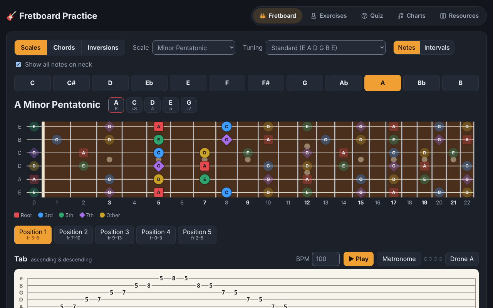
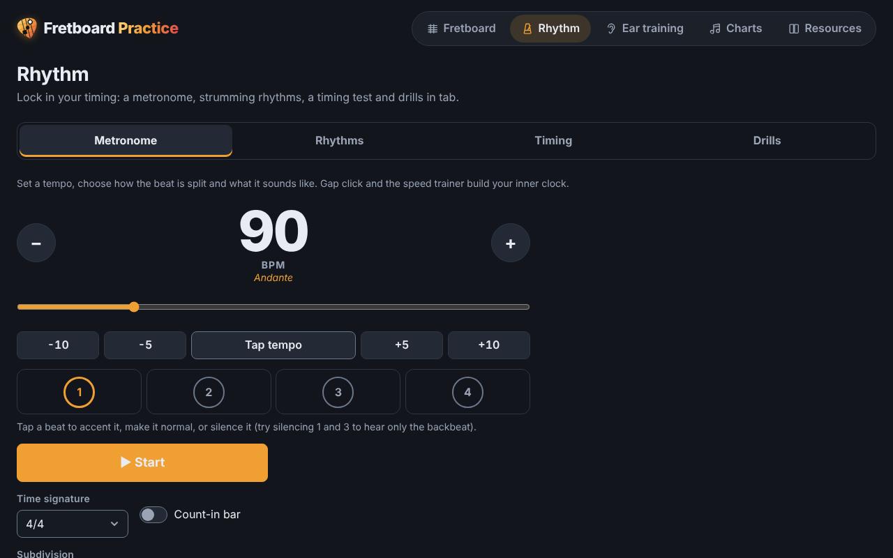
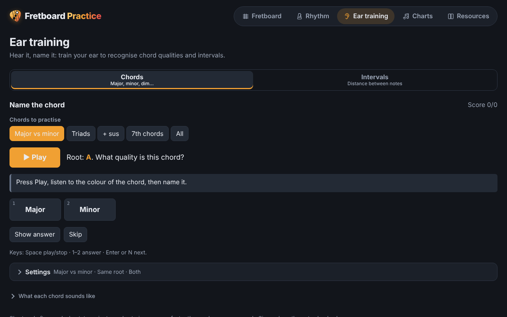
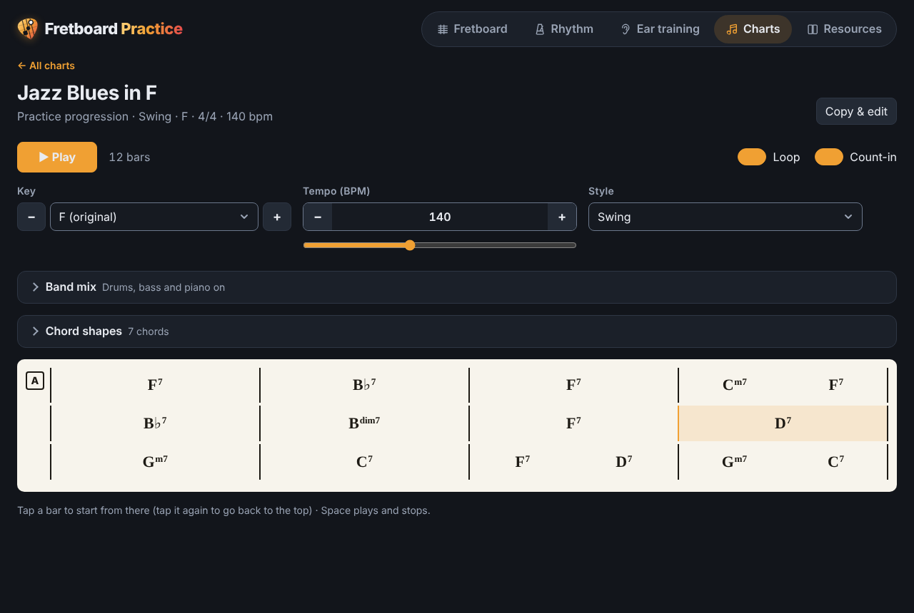
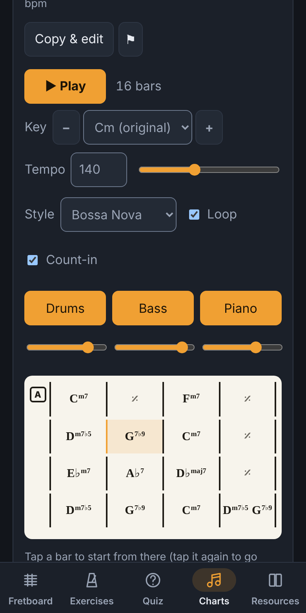

<div align="center">


# Fretboard Practice

**Scales, chords, ear training, exercises and play-along chord charts, all in one guitar practice site.**

[](https://github.com/joeyf116/music/actions/workflows/deploy.yml)


### [▶ Open the live site](https://joeyf116.github.io/music/)



</div>

---

## Contents

- [What's inside](#whats-inside)
- [Fretboard](#-fretboard)
- [Exercises](#-exercises)
- [Quiz: guess the interval](#-quiz-guess-the-interval)
- [Charts: play along with a band](#-charts-play-along-with-a-band)
- [Resources](#-resources)
- [Works everywhere](#-works-everywhere)
- [Shared catalogs (Supabase)](#-shared-catalogs-supabase)
- [Development](#-development)
- [Project layout](#-project-layout)
- [Deployment](#-deployment)

## What's inside

| Page | What it's for |
| --- | --- |
| 🎯 **[Fretboard](https://joeyf116.github.io/music/#fretboard)** | See any scale, chord or inversion on a 22-fret neck, with tab you can play back |
| 🏋️ **[Exercises](https://joeyf116.github.io/music/#exercises)** | Generated technique, scale, arpeggio, rhythm and fingerstyle drills with synced tab playback |
| 👂 **[Quiz](https://joeyf116.github.io/music/#quiz)** | Ear training: hear two notes and name the interval |
| 🎼 **[Charts](https://joeyf116.github.io/music/#charts)** | iReal Pro-style chord charts with a drums, bass and piano backing band, plus a chart editor |
| 📚 **[Resources](https://joeyf116.github.io/music/#resources)** | A shared catalog of lessons, tabs, videos, PDFs and tools anyone can add to |

Each page has its own link, your settings are remembered in the browser, and nothing needs an account.

## 🎯 Fretboard

- **Every key, three modes.** Choose one of the 12 keys, then:
  - **Scales:** major, minor, pentatonics, blues, harmonic and melodic minor, and every mode. Scales are split into playable positions (3 notes per string for 7-note scales, boxes for pentatonic and blues).
  - **Chords:** 17 chord types with voicings found all the way up the neck.
  - **Inversions:** close triads and drop‑2 seventh chords on every adjacent string set, walking root → 1st → 2nd (→ 3rd) up the neck.
- **Notes are coloured and shaped by role** (root, 3rd, 5th, 7th, other), so the neck reads even without colour. Labels can show note names or intervals.
- **Tab under the neck** for whatever is selected. Click a column to hear it, step through with ← / →, or press **Play** at any BPM.
- **22 tunings** in four groups: standard down to B, drop tunings down to Drop A, open tunings (G, D, E, A, C and minors) and more.
- **Metronome and drone** right next to the tab player.

## 🏋️ Exercises



Drills built on the fly for any key, tuning and neck area, with tab and a fretboard that follow the playback:

- **Scales:** scale sequences (3s, 4s, in 3rds, 4ths, 6ths…) and scales along one string
- **Technique:** a subdivision ladder (quarters → 8ths → triplets → 16ths) and chromatic finger workouts
- **Arpeggios:** arpeggios through the key, chord arpeggio shapes and triads on a string set
- **Chords & rhythm:** progressions such as I–V–vi–IV with strum patterns
- **Fingerstyle:** Travis picking and other fingerpicking patterns

## 👂 Quiz: guess the interval



The root is shown on the neck, two notes are played, and you name the gap by ear. Start with the presets (Starter, + 3rds & 4th, All), play the notes up, down, together or mixed, set the fret range, and watch your score and best streak.

## 🎼 Charts: play along with a band



A lead-sheet player inspired by [iReal Pro](https://www.irealpro.com/):

- **A catalog of more than 70 charts:** jazz standards (Autumn Leaves, All the Things You Are, Fly Me to the Moon, Body and Soul…), blues, latin (Blue Bossa, The Girl from Ipanema), pop & rock, folk & country, traditional tunes and practice progressions. You can search it and filter by genre or style.
- **A synthesized backing band** (Web Audio, nothing to download) with drums, walking or patterned bass and voice-led piano in 9 styles: swing, ballad, bossa nova, rock, pop, funk, blues shuffle, jazz waltz and country/folk.
- **Practice controls:** transpose to any key, change the tempo while it plays, loop, count-in, a mixer with volume and mute for each instrument, and tap any bar to start from there. Space plays and stops.
- **Chord shapes:** open the fold-away strip above the chart to see a chord box for every chord, with up to four voicings each (cycle with ‹ ›). Tap a box to hear it. The chord the band is playing is lit, and shapes follow your tuning.
- **A chart editor:** type `Dm7 G7` into a bar box, or paste a whole line like `| C | Am | F G | C |`. `/` holds a chord, `%` repeats a bar and `NC` is a break. It understands symbols like `F#m7b5`, `Bbmaj7`, `G7#9`, `Eb13`, `C/E`, `-7`, `^7`, `ø` and `o7`, and a live band preview plays while you write.
- **Share or keep:** save a chart in your own browser, or share it with everyone. Whoever shared a chart can edit or delete it from the same browser, and anyone can report one.

<details>
<summary><b>How the chart text works</b></summary>

| You type | Means |
| --- | --- |
| `Cmaj7` | One chord for the whole bar |
| `Dm7 G7` | Two chords, two beats each (in 4/4) |
| `C / / A7` | Three beats of C, one of A7 |
| `%` | Repeat the previous bar |
| *(empty)* | Keep the last chord ringing |
| `NC` | No chord: the band rests |
| `C/E` | C with E in the bass |

Built-in charts live in [`src/lib/chartLibrary.js`](src/lib/chartLibrary.js). The 50 seeded shared charts live in [`supabase/seed/popular-charts.js`](supabase/seed/popular-charts.js) (chords and form only, no melody or lyrics).

</details>

## 📚 Resources

A practice catalog of PDFs, tabs, lessons, videos, backing tracks and tools:

- Filter by type, tag, level and category, search every field, sort by newest and star your favourites.
- Look any song up on Songsterr, Ultimate Guitar or YouTube with the tab finder.
- **+ Add a resource** shares a link with every visitor, or keeps it in your own browser.
- Files dropped into [`resources/`](resources/README.md) (sub-folders become categories) and links in `resources/links.json` are bundled with the site.

## 📱 Works everywhere



- Phones get a bottom tab bar within thumb reach and nothing pinned over the top of the page.
- Touch targets are 44px, the neck scrolls to the selected shape, tab reflows to the screen and charts keep four bars to a line.
- Fields never trigger zoom on iOS, contrast meets WCAG AA, and keyboard focus is always visible.
- The site is fully static and works on GitHub Pages or any sub-path.

<br clear="right">

## 🗄️ Shared catalogs (Supabase)

Shared resources and shared charts are stored in a free [Supabase](https://supabase.com) project (`guitar-music`). The site talks to it with plain `fetch`, so there's no SDK to install. The public anon key in [`.env.production`](.env.production) is safe to publish, because database rules decide what it can do:

- Visitors can **read** approved rows, **add** a row, **edit or remove their own** (with a secret token kept in their browser) and **report** a row. A row is hidden automatically after 3 reports.
- Flood limits, length checks, URL and chart-shape checks run in the database.

| File | What it sets up |
| --- | --- |
| [`supabase/schema.sql`](supabase/schema.sql) | Shared resources table and functions |
| [`supabase/charts.sql`](supabase/charts.sql) | Shared charts table and functions |
| [`supabase/seed/popular-charts.sql`](supabase/seed/popular-charts.sql) | The 50 popular charts (generated, see below) |

Setup steps are in [`supabase/README.md`](supabase/README.md). If the database can't be reached, every page still works: shared items are simply hidden.

## 🛠 Development

```bash
npm install
npm run dev          # dev server with hot reload
npm test             # unit tests (Vitest)
npm run lint         # lint (oxlint)
npm run build        # production build into dist/
npm run seed:charts  # rebuild supabase/seed/popular-charts.sql from popular-charts.js
```

To use the shared catalogs locally, copy the two `VITE_SUPABASE_*` lines from `.env.production` into `.env.local` (git-ignored).

## 🗂 Project layout

```text
src/
├── App.jsx                 pages, header and the Fretboard page
├── components/             one file per page or widget (Charts, Exercises, Quiz, Resources, Tab, …)
└── lib/
    ├── theory.js           notes, scales, chords, voicings, inversions, tunings
    ├── exercises.js        exercise generators        player.js   tab playback
    ├── intervalQuiz.js     quiz logic                  audio.js    plucked-string synth, metronome, drone
    ├── chart.js            chord-symbol parser, transposition, chart compiler
    ├── arranger.js         band styles: drum patterns, bass lines, comping, voicings
    ├── band.js             Web Audio backing band scheduler
    └── shared*.js          Supabase calls for shared resources and charts
supabase/                   database SQL and seed data
resources/                  bundled PDFs, files and links
```

The music logic is plain JavaScript with tests next to it (`*.test.js`), separate from the React components.

## 🚀 Deployment

[`.github/workflows/deploy.yml`](.github/workflows/deploy.yml) lints, tests and builds every push and pull request, then deploys `dist/` to GitHub Pages on pushes to `main`.

One-time setup: **Settings → Pages → Source → GitHub Actions**.

<div align="center">
<sub>Built with React, Vite and the Web Audio API · Happy practising! 🎶</sub>
</div>
